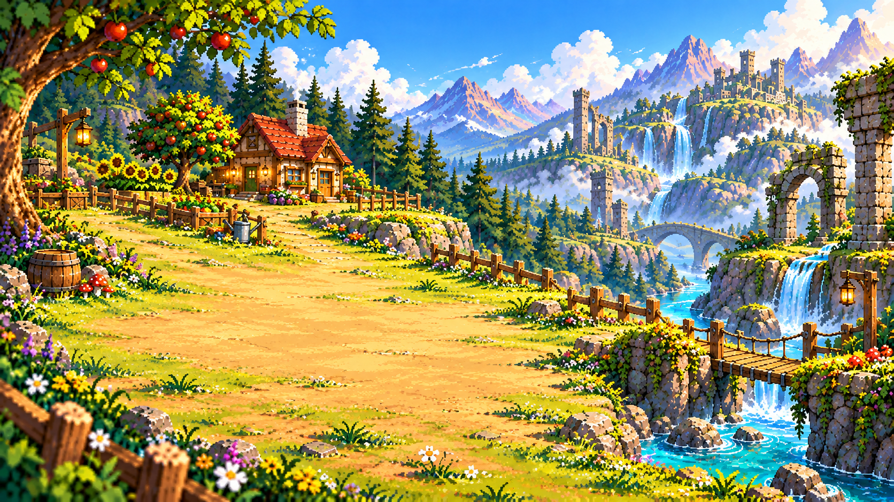

<div align="center">

<h1>🌿 Slimekeepers: Lost Valley</h1>

<strong>Um vale selvagem, uma fazenda para construir e slimes para descobrir</strong>

<p>Jogo indie 2D de exploração, cultivo, coleta e construção desenvolvido com Godot.</p>

<a href="https://godotengine.org/"></a>
<a href="https://github.com/HelioConde/Slime-Harvest"></a>

<p><a href="#jogar-no-godot"><strong>Como jogar</strong></a> · <a href="docs/roadmap_godot.md"><strong>Roadmap</strong></a> · <a href="docs/gameplay_polish.md"><strong>Polimento</strong></a></p>

</div>



*Arte utilizada no menu principal — não é uma captura de gameplay.*

## Sobre o jogo

**Slimekeepers: Lost Valley** é um projeto cozy/fantasia voltado ao prazer de explorar um mundo vivo. A progressão combina tarefas de fazenda, coleta e construção com criaturas que pertencem ao ecossistema selvagem.

**Estado atual:** protótipo em desenvolvimento, com sistemas jogáveis e demos de teste. Alguns recursos ainda estão em integração ou dependem de validação visual dentro do Godot.

## Sistemas e mecânicas

| Sistema | Implementação descrita |
| --- | --- |
| **Personagem** | Movimentação 2D, câmera, corrida e animações direcionais |
| **Ferramentas** | Hotbar com dez posições, machado, picareta, enxada e regador |
| **Recursos** | Árvores, tocos, pedras, flores e cogumelos com drops |
| **Fazenda** | Preparo do terreno, cultivo experimental, rega e passagem de dias |
| **Construção** | Casas/estruturas integradas ao mundo principal |
| **Criaturas** | Slimes ambientais com temperamentos e comportamentos diferentes |
| **Persistência** | Alguns recursos e estados salvos; sistema completo ainda em evolução |

### O que torna o vale especial

Os slimes não são apenas itens de coleção. A direção de design prioriza **criaturas com necessidades e comportamentos ambientais**. Explorar, observar e interagir com o ambiente devem ter importância semelhante ao cultivo e à construção.

## Jogar no Godot

**Requisito:** Godot 4.x — o `project.godot` atual declara recursos de **Godot 4.7**. Recomenda-se essa versão para reproduzir o estado do projeto.

1. Clone ou baixe [este repositório](https://github.com/HelioConde/Slime-Harvest).
2. Abra **`project.godot`** no editor Godot.
3. Espere terminar a importação de recursos.
4. Pressione **F5** para executar o menu `scenes/ui/MainMenu.tscn`.

### Controles e testes

| Ação | Controle |
| --- | --- |
| Movimento | `WASD` ou setas |
| Correr | `Shift` |
| Interagir | `E` |
| Usar ferramenta equipada | `F` |
| Selecionar hotbar | `1`–`9`, `0` ou clique |
| Atalho para picareta | `P` |

Cenas úteis para testar sistemas isolados:

- `scenes/world/World.tscn` — mundo principal.
- `scenes/trees/TreeChopDemo.tscn` — árvores, mineração e coleta.
- `scenes/farming/FarmingToolDemo.tscn` — enxada, rega e cultivo.
- `scenes/trees/FruitTreesDemo.tscn` — árvores frutíferas.
- `scenes/world/TerrainGallery.tscn` — amostras de terreno.

Abra a cena desejada no editor e execute com **F6**.

## Estrutura do projeto

```text
project.godot    Configuração do jogo
assets/          Personagens, tilesets, slimes e UI
scenes/          Menu, mundo e cenas de sistemas
scripts/         Regras, ferramentas e lógica de gameplay
data/            Dados auxiliares do jogo
docs/            Guias de mecânicas e planejamento
tools/           Verificações de integridade e recursos
tests/           Testes e suporte à validação
```

Para verificar referências estruturais:

```bash
python tools/validate_godot_project.py
```

A verificação estática **não substitui** abrir e executar o jogo no Godot, especialmente para colisões, animações, caminhos de sprites e UI.

## Roadmap e documentação

**Prioridades de desenvolvimento:** consolidar o mundo jogável, finalizar os ciclos de ferramentas e fazenda, aprimorar animações e interface, integrar salvamento e revisar o comportamento dos slimes.

| Área | Guia |
| --- | --- |
| Próximos marcos | [Roadmap Godot](docs/roadmap_godot.md) |
| Ferramentas e inventário | [Ferramentas](docs/tool_inventory.md) |
| Cultivo | [Loop de fazenda](docs/farming_loop.md) |
| Construção | [Casas](docs/house_building.md) |
| Ecossistema dos slimes | [Mundo selvagem](docs/wild_ecosystem_1_0.md) |
| Salvamento | [Slots](docs/save_slots.md) |
| Histórico de integração | [Documentação anterior](docs/README_REFERENCE_2026-10-25.md) |

### Outras implementações

Este repositório se chama **`Slime-Harvest`** por razões históricas (FarmSlime / Slime Harvest), mas o nome exibido no jogo é **Slimekeepers: Lost Valley**. Existe também [outra implementação do universo Slimekeepers](https://github.com/HelioConde/Slimekeepers-Lost-Valley), mantida separadamente. **Não presuma que as cenas ou recursos sejam intercambiáveis.**

## Recursos e direitos de uso

Parte dos sprites ou pacotes visuais pode ter **licenças próprias**. O uso no projeto não significa autorização para redistribuição isolada ou uso comercial. Consulte as fontes e condições de cada asset antes de copiar ou publicar.

---

<div align="center"><strong>Desenvolvido por <a href="https://github.com/HelioConde">Hélio Conde</a></strong></div>
